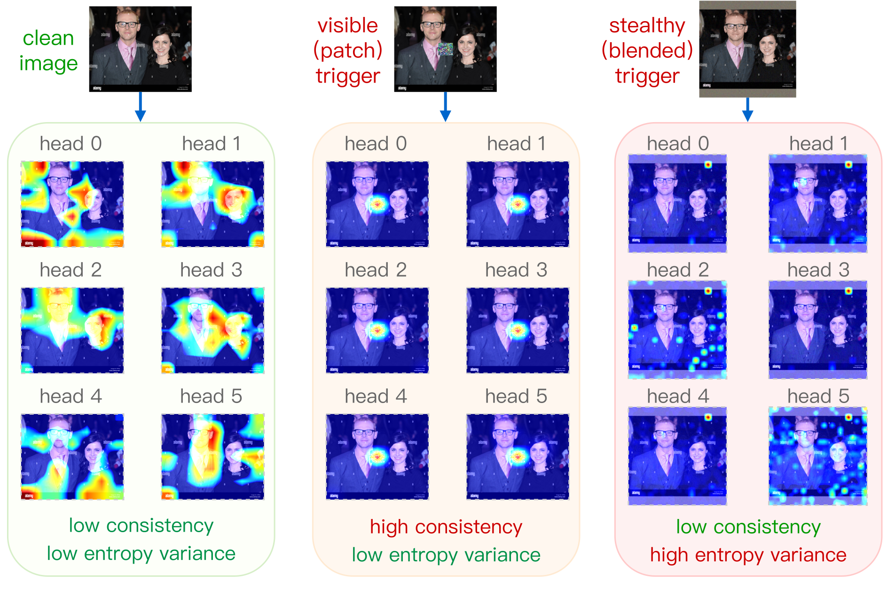
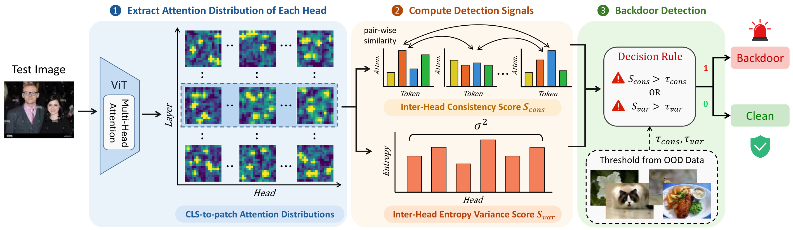
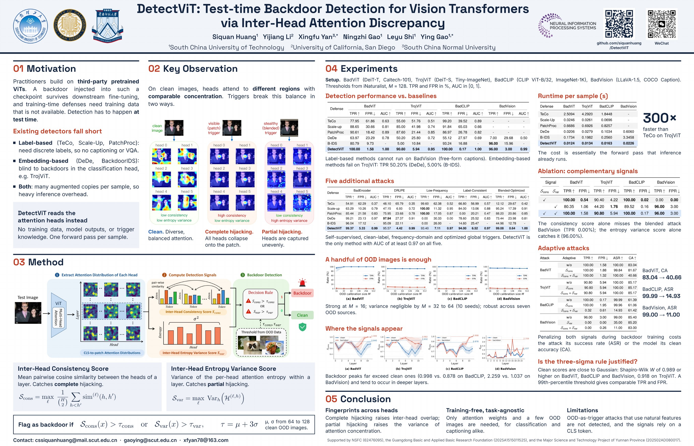

<div align="center">

# DetectViT: Test-time Backdoor Detection for Vision Transformers via Inter-Head Attention Discrepancy

**Siquan Huang**<sup>1</sup>, **Yijiang Li**<sup>2</sup>, **Xingfu Yan**<sup>3,\*</sup>, **Ningzhi Gao**<sup>1</sup>, **Leyu Shi**<sup>1</sup>, **Ying Gao**<sup>1,\*</sup>

<sup>1</sup>South China University of Technology &nbsp; <sup>2</sup>University of California, San Diego &nbsp; <sup>3</sup>South China Normal University

<sup>\*</sup>Corresponding authors

[](https://neurips.cc/virtual/2026/loc/sydney/poster/151934)
[](https://arxiv.org/abs/2611.23770)
[](assets/DetectViT_NeurIPS2026_poster.pdf)
[](LICENSE)

</div>

---

## News

- **[2026/11]** The NeurIPS 2026 poster and project figures are released.
- DetectViT has been accepted to **NeurIPS 2026**.

---

## Overview

Vision Transformers (ViTs) are the visual encoder of most multimodal models, and practitioners routinely build on third-party pretrained checkpoints that may carry a backdoor. **DetectViT** is a test-time backdoor sample detector for ViTs that reads the attention heads instead of the model's outputs or embeddings.

- **Training-free.** No access to training data and no auxiliary model to train.
- **Output-free.** Works for both classification and open-ended generation (e.g. image captioning with LLaVA).
- **Trigger-agnostic.** No prior knowledge of the trigger type is required.
- **Lightweight.** One forward pass per test sample; detection reuses attention weights already computed during inference.

### Key observation

On clean images, attention heads attend to **different regions** with **comparable concentration**. Backdoor triggers break this balance in two ways:

- **Complete attention hijacking.** A visible, localized trigger pulls *all* heads onto the same region, producing abnormally high inter-head spatial overlap.
- **Partial attention hijacking.** A stealthy, global trigger captures heads *unevenly*, producing an abnormally large variance in attention concentration across heads.

<p align="center">
  
</p>

### Method

<p align="center">
  
</p>

DetectViT extracts the CLS-to-patch attention distribution of every head and computes two complementary signals:

- **Inter-Head Consistency Score** $\mathcal{S}_{\text{cons}}$: the mean pairwise cosine similarity between the heads of a layer (max over layers). It captures complete hijacking.
- **Inter-Head Entropy Variance Score** $\mathcal{S}_{\text{var}}$: the variance of per-head attention entropy within a layer (max over layers). It captures partial hijacking.

Thresholds are estimated with the three-sigma rule, $\tau = \mu + 3\sigma$, from only **64 to 128 clean out-of-distribution images of any source**. A test sample is flagged as backdoored if $\mathcal{S}_{\text{cons}} > \tau_{\text{cons}}$ **or** $\mathcal{S}_{\text{var}} > \tau_{\text{var}}$.

---

## Main Results

Detection performance on four ViT backdoor attacks. TPR and FPR are in %, AUC is on a [0, 1] scale. "–" means the method is not applicable (label-based methods cannot handle free-form captions) or does not produce a continuous score.

| Defense | BadViT<br>TPR↑ / FPR↓ / AUC↑ | TrojViT<br>TPR↑ / FPR↓ / AUC↑ | BadCLIP<br>TPR↑ / FPR↓ / AUC↑ | BadVision<br>TPR↑ / FPR↓ / AUC↑ |
|---|---|---|---|---|
| TeCo | 77.95 / 61.86 / 0.63 | 55.00 / 51.76 / 0.51 | 99.20 / 39.52 / 0.89 | – |
| Scale-Up | 88.65 / 30.66 / 0.81 | 85.00 / 41.98 / 0.74 | 91.84 / 65.03 / 0.66 | – |
| PatchProc | 90.61 / 18.42 / 0.89 | 87.60 / 21.44 / 0.85 | 86.97 / 26.78 / 0.82 | – |
| DeDe | 63.97 / 23.29 / 0.78 | 50.20 / 25.80 / 0.72 | 55.12 / 27.97 / 0.69 | 7.00 / 29.68 / 0.50 |
| BackdoorIDS | 80.79 / 9.73 / – | 5.00 / 10.84 / – | 93.24 / 16.88 / – | **96.00** / 15.96 / – |
| **DetectViT** | **100.00 / 1.58 / 1.00** | **90.80 / 5.94 / 0.95** | **100.00 / 0.17 / 1.00** | **96.00 / 3.00 / 0.99** |

**Additional attacks.** On five further attacks covering self-supervised encoders (BadEncoder, DRUPE), clean-label poisoning (Label-Consistent), frequency-domain triggers (Low-Frequency) and optimized global triggers (Blended-Optimized), DetectViT is the only method that keeps an AUC of at least 0.97 on all of them. Full results are in the appendix of the paper.

**Runtime.** Average per-sample detection time (s):

| Defense | BadViT | TrojViT | BadCLIP | BadVision |
|---|---|---|---|---|
| TeCo | 2.5094 | 4.2920 | 1.8448 | – |
| Scale-Up | 0.0246 | 0.0261 | 0.0696 | – |
| PatchProc | 0.6686 | 0.6926 | 0.8257 | – |
| DeDe | 0.0206 | 0.0279 | 0.1034 | 0.6060 |
| BackdoorIDS | 0.1734 | 0.1982 | 0.2560 | 3.3458 |
| **DetectViT** | **0.0124** | **0.0134** | **0.0163** | **0.0226** |

---

## Poster

<p align="center">
  <a href="assets/DetectViT_NeurIPS2026_poster.pdf">
    
  </a>
</p>

<p align="center">Click the image to open the full-resolution PDF.</p>

---

## Installation

```bash
git clone https://github.com/siquanhuang/DetectViT.git
cd DetectViT
```

### Prerequisites

- Python 3.10.5
- PyTorch 2.1.2
- CUDA 11.8

---

## Pretrained Attack Models & Triggers

Download the pretrained backdoored model checkpoints and optimized triggers from Google Drive:

**[[Google Drive Link]](https://drive.google.com/drive/folders/1x1SNcuoytybCdd42HIMeYjgoM4ecptG7?usp=sharing)**

---

## Usage

The detection method is implemented in `detectvit.py`. Run `main.py` to evaluate DetectViT against each attack.

### BadViT

```bash
python3 main.py \
  --defense DetectViT \
  --attack_type badvit \
  --trojvit_attack_dir TrojViT/logs/Caltech101_DeiT-T_target0_BadViT \
  --trojvit_network DeiT-T \
  --trojvit_num_classes 102 \
  --trojvit_data_dir ./data
```

### TrojViT

```bash
python3 main.py \
  --defense DetectViT \
  --attack_type trojvit \
  --trojvit_attack_dir TrojViT/logs/Tiny-ImageNet_DeiT-S_target2_TrojViT \
  --trojvit_data_dir ./data/tiny-imagenet-200 \
  --trojvit_network DeiT-S \
  --gpu 0
```

### BadCLIP

```bash
python3 -u main.py \
  --defense DetectViT \
  --attack_type badclip \
  --gpu 0 \
  --eval_data_type ImageNet1K \
  --eval_test_data_dir BadCLIP/data/ImageNet1K/validation/ \
  --add_backdoor \
  --asr \
  --label banana \
  --patch_type ours_tnature \
  --patch_location middle \
  --patch_name BadCLIP/opti_patches/tnature_eda_bs64_ep50_32_middle_01_05_pos_neg.jpg \
  --patch_size 32
```

### BadVision

```bash
python3 -u main.py \
  --defense DetectViT \
  --attack_type badvision \
  --gpu 0
```

---

## Key Arguments

| Argument | Description | Default |
|---|---|---|
| `--defense` | Detection method (`DetectViT`, `DeDe`, `BackdoorIDS`, ...) | `DetectViT` |
| `--attack_type` | Attack to evaluate (`badvit`, `trojvit`, `badclip`, `badvision`) | — |
| `--gpu` | GPU device ID | `0` |

---

## Citation

If you find this work useful, please consider citing our paper. 

```bibtex
@misc{huang2026detectvittesttimebackdoordetection,
      title={DetectViT: Test-time Backdoor Detection for Vision Transformers via Inter-Head Attention Discrepancy}, 
      author={Siquan Huang and Yijiang Li and Xingfu Yan and Ningzhi Gao and Leyu Shi and Ying Gao},
      year={2026},
      eprint={2611.23770},
      archivePrefix={arXiv},
      primaryClass={cs.CV},
      url={https://arxiv.org/abs/2611.23770}, 
}
```

---

## Acknowledgements

This project builds upon the following open-source works. We sincerely thank the authors for releasing their code:

- **TrojViT** — [https://github.com/mxzheng/TrojViT](https://github.com/mxzheng/TrojViT)
- **BadCLIP** — [https://github.com/LiangSiyuan21/BadCLIP](https://github.com/LiangSiyuan21/BadCLIP)
- **BadVision** — [https://github.com/6zHAOyi/BadVision](https://github.com/6zHAOyi/BadVision)
- **DeDe** — [https://github.com/tardisblue9/DeDe](https://github.com/tardisblue9/DeDe)
- **BackdoorIDS** — [https://github.com/siquanhuang/BackdoorIDS](https://github.com/siquanhuang/BackdoorIDS)
